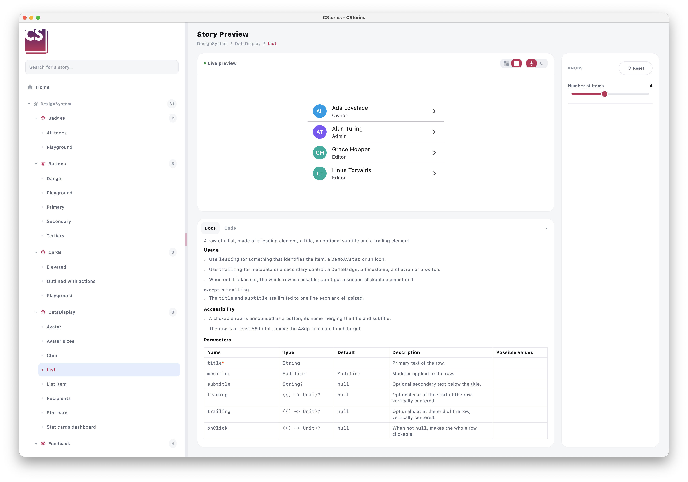

# Document a component

When a component is annotated with `@CStoryComponent`, its KDoc becomes the source of truth for the catalog's
documentation panel — no separate documentation to maintain.



## Writing useful KDoc

```kotlin
/**
 * High-emphasis filled button, used for the main call-to-action.
 *
 * @param text Label displayed inside the button.
 * @param onClick Called when the button is clicked.
 */
@CStoryComponent
@Composable
fun PrimaryButton(text: String, onClick: () -> Unit) { /* ... */ }
```

The description and the `@param` tags are picked up and rendered in the story's documentation panel, next to the
live preview. A `@return` tag is rendered too.

The first paragraph of the description is also used as the component's summary on the
[home page](/guides/home-page): keep it to one or two sentences.

## Formatting with Markdown

The description supports Markdown: `###` headings, bulleted lists, tables, **bold**, *italics*, inline code and fenced
code blocks. Kotlin code blocks are syntax-highlighted and come with a copy button, which makes them a good place for
usage examples:

````kotlin
/**
 * High-emphasis filled button, used for the main call-to-action.
 *
 * ### Usage
 * - Keep one primary button per screen.
 * - Use a verb as label ("Save", "Send invitation").
 *
 * ### Example
 * ```kotlin
 * PrimaryButton(
 *     text = "Save",
 *     onClick = { viewModel.save() },
 * )
 * ```
 *
 * @param text Label displayed inside the button.
 * @param onClick Called when the button is clicked.
 */
````

## Limitations

- Only `@param` and `@return` are rendered. Other tags (`@see`, `@sample`, `@throws`, `@property`...) are ignored and
  reported as a KSP warning.
- A line starting with `@` is always read as a tag, even inside a code block: avoid annotations such as `@Composable`
  at the start of a line in examples.
- Text between square brackets is rendered as inline code (KDoc links such as `[ButtonVariant]` become
  `ButtonVariant`), including inside code blocks: avoid brackets in code examples.

## Best practices

:::tip
- describe the component's **intent**, not just what it renders
- document parameters that actually influence behavior or appearance
- keep the description short — the documentation panel favors clarity over exhaustiveness
:::

## Across module boundaries

When a component lives in a different module than the story that demonstrates it (the `:lib` / `:lib:stories`
split), the KDoc still needs to reach the catalog even though `:lib:stories` never sees `:lib`'s source directly.

This works transparently: the resolved KDoc gets pre-rendered to Markdown and embedded as an annotation on the
matching `CStoryComponentRefs` property (annotations survive compilation, unlike KDoc comments), so the story's
module can read it back without needing access to the component's source. As a component author, you don't need to
do anything differently — writing the KDoc on the `@CStoryComponent` function is all that's required.
